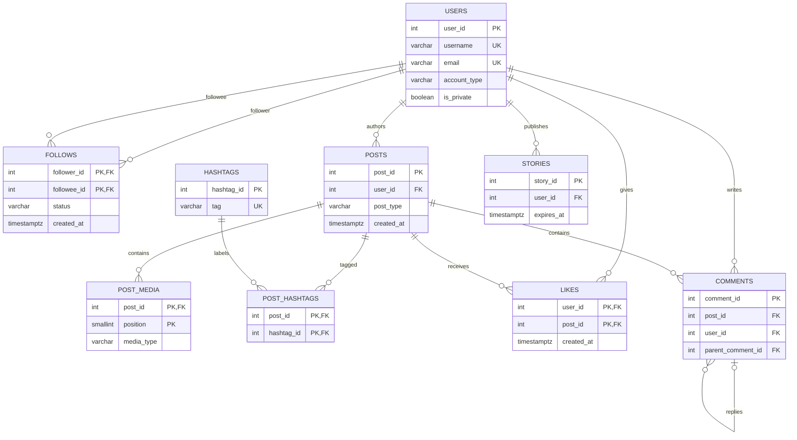

# Schema design and normalization

## Source and scope

The schema was reconstructed from all nine CSVs in `seed_data.zip`, using the exact CSV table and column names. The inputs contain 30,000 users, 258,588 follows, 50 hashtags, 60,000 posts, 150,000 post-hashtag links, 89,854 media rows, 419,954 likes, 150,000 comments, and 40,000 stories. The CREATE statements are in [`01_schema.sql`](../sql/01_schema.sql); loading instructions are in [`02_load_data.sql`](../sql/02_load_data.sql).

## Data dictionary

`PK` primary key, `FK` foreign key, `UQ` unique, `NN` not null, `CK` check. Integer IDs use `INTEGER`; timestamp strings include `+05:30`, so all timestamps use `TIMESTAMPTZ` and preserve the instant.

| Table | Column | Type | Constraint | Rationale |
|---|---|---|---|---|
| users | user_id | INTEGER | PK | Stable account identifier. |
| users | username | VARCHAR(30) | NN, UQ, CK | Required handle; lowercase letters, digits, dot, underscore. |
| users | full_name | VARCHAR(100) | NN | Display name. |
| users | email | VARCHAR(254) | NN, UQ | Contact address and candidate key in this export. |
| users | bio | TEXT | nullable | Optional profile text; 13,429 rows are empty. |
| users | account_type | VARCHAR(10) | NN, CK | PERSONAL, CREATOR, BUSINESS. |
| users | is_private | BOOLEAN | NN; table CK | Privacy state; business accounts must be public. |
| users | is_verified | BOOLEAN | NN | Verification flag. |
| users | followers_count | INTEGER | NN, CK >= 0 | Stored counter retained for profile/query compatibility; can drift. |
| users | following_count | INTEGER | NN, CK >= 0 | Stored counter retained for profile/query compatibility. |
| users | created_at | TIMESTAMPTZ | NN | Account creation instant. |
| follows | follower_id | INTEGER | PK part, FK users ON DELETE CASCADE, CK | Account initiating relationship; cascade when account is removed. |
| follows | followee_id | INTEGER | PK part, FK users ON DELETE CASCADE, CK | Target account; self-follow is prohibited. |
| follows | status | VARCHAR(10) | NN, CK | ACCEPTED or PENDING. |
| follows | created_at | TIMESTAMPTZ | NN | Follow/request creation time. |
| hashtags | hashtag_id | INTEGER | PK | Stable tag identifier. |
| hashtags | tag | VARCHAR(30) | NN, UQ, CK | Canonical lowercase tag, without `#`. |
| posts | post_id | INTEGER | PK | Stable post identifier. |
| posts | user_id | INTEGER | NN, FK users ON DELETE CASCADE | Author; author deletion removes owned posts. |
| posts | post_type | VARCHAR(10) | NN, CK | PHOTO, VIDEO, CAROUSEL, REEL. |
| posts | caption | TEXT | nullable | Optional caption; 8,950 rows empty. |
| posts | location_name | VARCHAR(100) | nullable | Optional free-form place; 41,818 rows empty. |
| posts | like_count | INTEGER | NN, CK >= 0 | Stored counter retained for supplied queries; seed count matches likes. |
| posts | comment_count | INTEGER | NN, CK >= 0 | Stored counter retained for supplied queries; seed count matches comments. |
| posts | is_archived | BOOLEAN | NN | Archive state. |
| posts | created_at | TIMESTAMPTZ | NN | Post creation instant. |
| post_hashtags | post_id | INTEGER | PK part, FK posts ON DELETE CASCADE | Post side of M:N tag relationship. |
| post_hashtags | hashtag_id | INTEGER | PK part, FK hashtags ON DELETE RESTRICT | Tag side; referenced tags cannot be deleted while used. |
| post_media | post_id | INTEGER | PK part, FK posts ON DELETE CASCADE | Owning post. |
| post_media | position | SMALLINT | PK part, NN, CK 1–10 | Media order; combined key enforces one item per position. |
| post_media | media_type | VARCHAR(5) | NN, CK | IMAGE or VIDEO. |
| post_media | media_url | TEXT | NN | Media location. |
| post_media | width | SMALLINT | NN, CK > 0 | Pixel dimension. |
| post_media | height | SMALLINT | NN, CK > 0 | Pixel dimension. |
| post_media | duration_sec | NUMERIC(6,1) | nullable, CK | Decimal seconds; required and positive for VIDEO, absent for IMAGE. |
| likes | user_id | INTEGER | PK part, FK users ON DELETE CASCADE | Liking account. |
| likes | post_id | INTEGER | PK part, FK posts ON DELETE CASCADE | Liked post. |
| likes | created_at | TIMESTAMPTZ | NN | Like time. |
| comments | comment_id | INTEGER | PK | Stable comment identifier. |
| comments | post_id | INTEGER | NN, FK posts ON DELETE CASCADE | Post being discussed. |
| comments | user_id | INTEGER | NN, FK users ON DELETE CASCADE | Comment author. |
| comments | parent_comment_id | INTEGER | nullable, self-FK ON DELETE CASCADE | NULL means top-level comment; otherwise reply. |
| comments | body | TEXT | NN | Comment text. |
| comments | is_hidden | BOOLEAN | NN | Moderation visibility flag. |
| comments | created_at | TIMESTAMPTZ | NN | Comment time. |
| stories | story_id | INTEGER | PK | Stable story identifier. |
| stories | user_id | INTEGER | NN, FK users ON DELETE CASCADE | Story owner. |
| stories | media_type | VARCHAR(5) | NN, CK | IMAGE or VIDEO. |
| stories | created_at | TIMESTAMPTZ | NN | Story creation instant. |
| stories | expires_at | TIMESTAMPTZ | NN, CK | Exactly 24 hours after creation in all seed rows. |
| stories | view_count | INTEGER | NN, CK >= 0 | Nonnegative stored aggregate. |

## ER diagram

The rendered diagram is [`er_diagram.png`](../diagrams/er_diagram.png). Mermaid source:

Cardinalities: each user authors zero or many posts/stories/comments and can give many likes; each post has one author and may have many media items, hashtags, likes and comments; users relate to users through the follows association; posts relate to hashtags through post_hashtags; comments form an optional parent-child tree.

## Constraints and normalization

The schema contains more than 12 domain checks: handle and tag formats; allowed account, follow, post and media types; business accounts public; no self-follow; nonnegative counters; positive media dimensions; bounded media positions; video duration present and positive iff video; nonnegative story views; and 24-hour story expiry. IDs, attributes, lengths, media dimensions/durations and all seed value sets were inspected. CSV empty fields are NULL for bio, caption, location_name, post_media.duration_sec and comments.parent_comment_id; other columns are populated. Empty parent ID represents a root comment.

Functional dependencies (each row is the determinant → dependent attributes; non-key attributes depend on the whole key and nothing but the key):

| Table | Functional dependency | Normal form |
|---|---|---|
| users | user_id → all other columns; username → user_id and remaining attributes; email → user_id and remaining attributes | BCNF under the declared candidate keys. |
| follows | (follower_id, followee_id) → status, created_at | BCNF; relationship attributes depend on the pair. |
| hashtags | hashtag_id → tag; tag → hashtag_id | BCNF. |
| posts | post_id → all other columns | BCNF relative to the selected key. |
| post_hashtags | (post_id, hashtag_id) → no non-key attributes | BCNF; pure association. |
| post_media | (post_id, position) → media_type, media_url, width, height, duration_sec | BCNF; media item facts depend on the full key. |
| likes | (user_id, post_id) → created_at | BCNF. |
| comments | comment_id → post_id, user_id, parent_comment_id, body, is_hidden, created_at | BCNF; recursive FK does not create a non-key dependency. |
| stories | story_id → user_id, media_type, created_at, expires_at, view_count | BCNF as stored; expiry is derivable from creation time. |

`followers_count`, `following_count`, `like_count`, and `comment_count` are aggregates derivable from relationship tables. They are stored to support the supplied workload and product profile reads, but this duplicates facts and can drift; the checks below expose that risk. In this seed, following, likes and comments counters match, but 1,200 follower counters do not. `stories.expires_at` is derivable from `created_at + 24 hours`; it remains stored for expiry filtering/cleanup and is constrained to that expression. These are intentional denormalizations for the project workload, not independent facts.

The recursive comments FK guarantees a referenced parent exists but a conventional CHECK cannot verify parent and reply share the same post. All seed replies do share the post. Likewise, “carousel has at least two media rows” is a cross-row assertion and cannot be enforced by a row CHECK; all seed carousels satisfy it. These rules should be checked by load validation or a trigger if the application must enforce them continuously. There are no custom indexes in this phase; PostgreSQL creates backing indexes for PK and UNIQUE constraints only.

## Load and integrity validation

The loader uses `\copy` in parent-before-child order and ends with `ANALYZE`. The seed audit produced these row counts:

| Table | Rows |
|---|---:|
| users | 30,000 |
| follows | 258,588 |
| hashtags | 50 |
| posts | 60,000 |
| post_hashtags | 150,000 |
| post_media | 89,854 |
| likes | 419,954 |
| comments | 150,000 |
| stories | 40,000 |

CSV-level integrity checks (expected result is zero violations unless stated):

| Check | Result |
|---|---:|
| Duplicate primary or composite keys across all nine files | 0 |
| Duplicate username/email/hashtag tag | 0 |
| Self-follows | 0 |
| Business accounts marked private | 0 |
| Video media missing duration or image media with duration | 0 |
| Replies whose parent belongs to a different post | 0 |
| Carousels with fewer than two media items | 0 |
| Stories whose expiry is not exactly 24 hours after creation | 0 |
| Users with stored following_count different from accepted follows | 0 |
| Posts with stored like_count/comment_count different from likes/comments | 0 / 0 |
| Users with stored followers_count different from accepted follows | 1,200 |

The last item is a data quality issue present in the source, not a load failure; do not add an equality constraint that would reject the supplied rows. As required, no additional index is introduced before baseline measurement.
